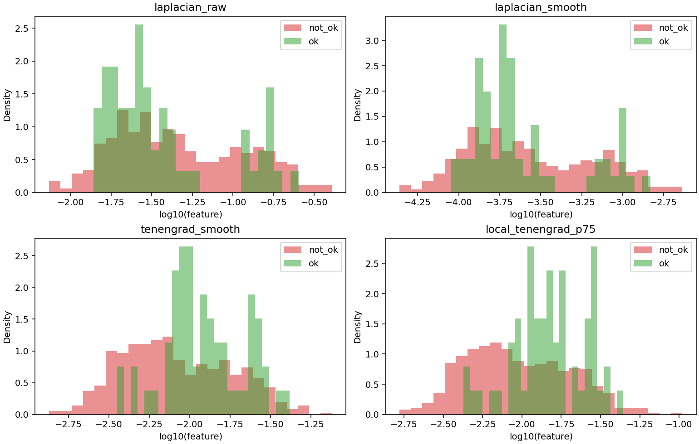
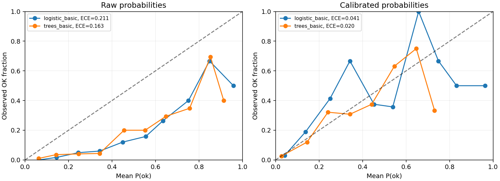
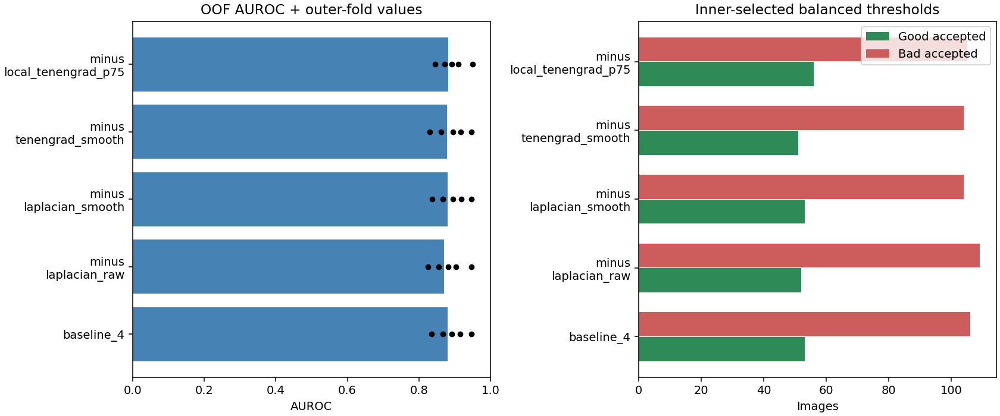

# Быстрый классификатор на четырёх признаках

Отдельная рабочая папка для развития **`logistic_basic` — логистической регрессии на четырёх показателях резкости**. Здесь собраны описание, выполненные ноутбуки, графики и воспроизводимый эксперимент. ExtraTrees на тех же входах служит сравнением.

Эта папка использует общий код и артефакты родительского проекта. **Копировать нужно весь репозиторий**, а не только `fast_focus_4/`. Для работы этой ветки исследования не нужны PyTorch, GPU и веса нейросети.

## Ноутбуки

| Файл | Содержание | Нужны исходные PNG для выполнения? |
| --- | --- | --- |
| [01_baseline_and_errors_RU.ipynb](01_baseline_and_errors_RU.ipynb) | Четыре признака, схема LR, текущие результаты, ROC/PR, ECE до/после калибровки, фотографии с правильными и ошибочными решениями | Только для повторного построения фотогалереи |
| [02_reproduce_and_ablate_RU.ipynb](02_reproduce_and_ablate_RU.ipynb) | Повторное обучение исходной LR-4 и четырёх вариантов с удалением по одному признаку; одинаковые части по пациентам; парные интервалы разности AUROC | Нет: используются сохранённые признаки |
| [03_predict_and_speed_RU.ipynb](03_predict_and_speed_RU.ipynb) | Оценка своего файла/папки, выбор LR или ExtraTrees, вероятности и решения, замер чтения, признаков и классификатора | Свои фотографии или скачанный датасет |

Открывать по порядку. В ноутбуках уже сохранены результаты выполнения и изображения; для их просмотра запускать обучение не требуется. Во втором ноутбуке `RUN_TRAINING=False` позволяет при повторном запуске прочитать сохранённые результаты без переобучения.

## Запуск

Из корня репозитория, Python 3.10 или 3.11:

```powershell
python -m venv .venv-focus4
.\.venv-focus4\Scripts\python.exe -m pip install -r fast_focus_4/requirements.txt
.\.venv-focus4\Scripts\python.exe -m ipykernel install --user --name capillary-focus4 --display-name "Capillary: 4 features"
.\.venv-focus4\Scripts\python.exe -m notebook fast_focus_4
```

Linux/macOS: вместо `.\.venv-focus4\Scripts\python.exe` использовать `.venv-focus4/bin/python`.
В интерфейсе Jupyter выбрать ядро **Capillary: 4 features**. Это связывает открытый ноутбук с установленными зависимостями нужного окружения.

Если нужны оригиналы для пересчёта фотогалереи и демонстрации:

```powershell
.\.venv-focus4\Scripts\python.exe scripts/download_data.py
```

Загрузка всех фотографий — около 1,7 ГБ; для второго ноутбука она не нужна.

Пересоздать и выполнить все три ноутбука:

```powershell
.\.venv-focus4\Scripts\python.exe fast_focus_4/build_notebooks.py
```

Для одного ноутбука добавить `--only 01`, `--only 02` или `--only 03`.
`--no-execute` создаёт ноутбуки без выполнения и сохранённых результатов.

## Точка отсчёта

Пять внешних частей по пациентам; обучение/метрики на **62 хороших и 503 плохих кадрах**. Ещё 435 спорных кадров исключены. Это внутренняя исследовательская проверка, а не новая независимая съёмка.

| Модель на 4 признаках | AUROC | AP | Precision / recall хороших, обычный режим | Приняты хорошие / плохие | ECE_ok, 10 интервалов |
| --- | ---: | ---: | ---: | ---: | ---: |
| **Логистическая регрессия — основа этой папки** | 0,880 | 0,468 | 0,333 / 0,855 | 53 / 106 | 0,0406 |
| ExtraTrees — сравнение | 0,875 | 0,503 | 0,374 / 0,742 | 46 / 77 | 0,0195 |

У LR AUROC 95% интервал 0,835–0,924, полученный повторными выборками пациентов при фиксированных внешних прогнозах. Нельзя понимать AUROC 0,880 как «88% фотографий классифицированы правильно».

**Модель различает часть хороших и плохих кадров, но текущий обычный отбор слишком загрязнён плохими фотографиями.** Строгий автодопуск у обеих моделей на четырёх признаках отключён: внутренние данные не дали подходящего порога по принятому правилу. Это исходная ситуация, которую предстоит улучшать.

В исходном замере на Intel i5-9300H у LR-4 медиана PNG → решение 63,5 мс, p95 140,8 мс; классификация уже рассчитанных четырёх чисел — около 1 мс. Основные затраты лежат в чтении и вычислении признаков. В этом эксперименте MobileNet имел сопоставимую общую задержку: название «быстрый» здесь обозначает выбранный простой подход, а не доказанное превосходство над всеми другими моделями.







Первый выполненный эксперимент воспроизвёл исходную LR-4. Удаление исходного лапласиана снизило AUROC до 0,870; удаление других входов изменило AUROC менее чем на 0,002. Во всех вариантах строгий допуск остался отключён, а обычный пропускает около сотни плохих кадров. Простое удаление признака задачу пока не решило; четыре входа сохранены как исходный вариант. Подробные числа и исследовательские интервалы — во втором ноутбуке и `results/`.

## Где что менять

- [METHOD_RU.md](METHOD_RU.md) — точное описание алгоритма, ограничения и порядок улучшений.
- [workbench.py](workbench.py) — загрузка таблиц, воспроизведение обучения, прогнозы и бенчмарк для этих ноутбуков.
- [build_notebooks.py](build_notebooks.py) — исходный код создания ноутбуков; при пересоздании ручные правки `.ipynb` будут заменены.
- `results/` — таблицы проведённой проверки удаления признаков, внешние прогнозы, интервалы и происхождение данных. Это **не новые рабочие веса**.
- `local_outputs/` — необязательный экспорт своих прогнозов; исключён из Git.

Используется общая реализация: [признаки](../focus_classifier/features.py), [обучение и калибровка](../focus_classifier/modeling.py), [исходные результаты](../focus_classifier/artifacts/metrics.json). Код вычисления признаков не дублируется. Ноутбуки не заменяют модели рабочего клиента и не перезаписывают исходную разметку.
