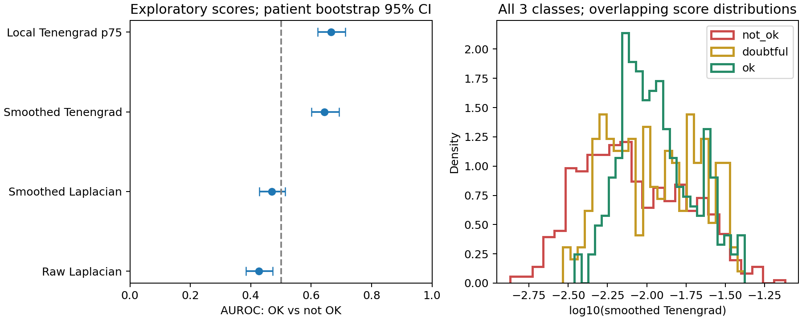

Исследование оценки качества капилляроскопии — 1 ноября 2026 года

**Дополнение после просмотра соседнего проекта `eyes`.** Там уже реализованы и обучены почти все предложенные ниже baseline-модели. Повторять их как новый план не требуется. См. [аудит существующего обучения и контрольный эксперимент по источникам разметки](EYES_REVIEW_RU.md): основное новое направление — проверка согласованности критериев и пограничных меток, затем разрешения входа. Этот первоначальный документ описывает аудит папки `резкость` до знакомства с обученными артефактами `eyes`.

**Рекомендация.** Для текущего проекта стоит делать классификатор **пригодности изображения для анализа сосудов** с тремя выходами: `not_ok`, `doubtful`, `ok`. Начать с модели на нескольких локальных признаках, затем сравнить её с небольшой предобученной CNN. Для автоматического отбора использовать откалиброванную вероятность `P(ok)` и порог, выбранный на валидации. Обычный порог резкости по лапласиану для этих данных не выглядит подходящим: проведённая ниже проверка показала слабое разделение классов.

Это исследование и подготовка проверки будущего классификатора. Нейросеть не обучалась; готовность системы к применению не установлена. Пользователь уточнил, что целевой материал — капилляроскопия из текущей папки. Методы для глазного дна рассматриваются только как аналогии.

**Что уже есть в проекте.**

В исходной папке обнаружен датасет `capillary_quality_1000`; исходного кода обучения, весов модели и её предсказаний нет. Проверены все 1000 PNG и соответствие SHA-256 манифесту. Размер каждого изображения — 1024 × 768, формат хранения — RGB. Несовпадений хешей, точных дубликатов файлов по содержимому, пропущенных изображений или повторяющихся имён разметки не найдено. Отсутствие точных дубликатов не исключает похожие кадры из одного видео.

| Параметр | Проверенное значение |
|---|---:|
| Изображения | 1000 |
| Исходные видео, представленные кадрами | 500 |
| Пациенты | 93 |
| Кадры на видео | Ровно 2 |
| Кадры на пациента: минимум / медиана / максимум | 2 / 12 / 12 |
| `not_ok` | 509 — 50,9% |
| `doubtful` | 210 — 21,0% |
| `ok` | 281 — 28,1% |

В `frames.json` значения имеют смешанные типы: `false`, строка `"unknown"`, `true`. Их нужно явно переводить в индексы `0, 1, 2`. Приведение через `bool(value)` ошибочно превратит строку `"unknown"` в истину. Согласно README, `unknown` — размеченный пограничный класс, а не отсутствие разметки.

Половина кадров имеет `annotator=human`, половина — `annotator=assistant`; README сообщает, что дополнительная разметка проверена пользователем. Доля `ok` составляет 20,6% в первой группе и 35,6% во второй. Это **не измерение несогласия разметчиков**: размечены разные кадры. Однако полезно отдельно проверять результаты по источнику разметки и сделать независимую повторную оценку части снимков, особенно пограничных. Для финального теста предпочтительна слепая экспертная разметка с разбором разногласий.

В папке есть только извлечённые фотографии, а не сами AVI. Проверить устойчивость видео, движение, длительность пригодного фрагмента и артефакты давления по этому набору невозможно. Также нет масок сосудов и эталонных измерений их диаметра: пригодность для количественных измерений пока представлена субъективной меткой.

**Что показывает литература и как это относится к задаче.**

Качество микрососудистой съёмки многокомпонентно. В исходной работе о Microcirculation Image Quality Score (MIQS) оцениваются освещение, длительность, фокус, содержимое, стабильность и давление. Это работа о сублингвальной SDF-видеомикроскопии, а не универсальный стандарт для любой капилляроскопии. Из неё полезно взять принцип: резкости недостаточно, а часть дефектов можно оценить только по видео. Точный тип прибора и область съёмки текущего набора из метаданных не установлены. [Massey et al., 2013](https://www.sciencedirect.com/science/article/pii/S0883944113001901).

Сравнительное исследование операторов фокуса рассматривает влияние шума, контраста, насыщения и размера окна. Его результаты относятся к задаче shape-from-focus и не дают готового универсального порога для нашего классификатора. Это основание проверять признаки на собственных данных, при фиксированном масштабе и предобработке. [Pertuz et al., 2013](https://isp-utb.github.io/seminario/papers/Pattern_Recognition_Pertuz_2013.pdf).

В анализе глазного дна есть полезный пример общей организации: AutoMorph соединяет оценку качества, сегментацию сосудов и измерение морфологии. EyeQ содержит 28 792 снимка сетчатки с классами Good / Usable / Reject. Эти данные и модели относятся к другому изображающему домену; готовые веса нельзя считать проверенным решением для наших кадров. Кроме того, `Usable` в EyeQ не равнозначно нашей неопределённой метке `doubtful`. [AutoMorph, 2022](https://pmc.ncbi.nlm.nih.gov/articles/PMC9290317/), [EyeQ — репозиторий авторов](https://github.com/HzFu/EyeQ).

Мой вывод для проекта: качество следует определять относительно конкретной операции — например, различимости мелких сосудов и допустимой ошибки их измерения. На первом этапе имеющиеся метки позволяют изучать воспроизведение пользовательской оценки пригодности. Для доказательства пригодности к измерениям понадобится дополнительная проверка самой сегментации/морфометрии.

**Предварительный эксперимент на ваших изображениях.**

Скрипт [audit_focus.py](audit_focus.py) вычисляет четыре показателя без обучения. Изображения переводятся в grayscale и диапазон `[0,1]`; исходный размер сохраняется. Лапласиан вычисляется с `ksize=1`. Для сглаженных признаков используется Gaussian σ=1 пиксель, для Tenengrad — средняя сумма квадратов Sobel-производных с ядром 3 × 3. Локальный вариант — 75-й процентиль средних энергий по сетке 4 × 4. Маска сосудов, нормализация локального контраста и подбор параметров не использовались.

Для простой проверки ранжирования взяты **790 кадров `ok` и `not_ok`**; 210 пограничных изображений сохранены в таблице и на графике, но исключены именно из бинарного расчёта AUROC. Положительный класс — `ok`, направление оценки заранее задано: больше показатель → лучше качество. Интервалы получены 1000 bootstrap-перевыборками целых пациентов с возвращением; метрика внутри выборки взвешена по кадрам.

| Признак | AUROC `ok` против `not_ok` | Приблизительный 95% интервал |
|---|---:|---:|
| Дисперсия лапласиана исходного изображения | 0,427 | 0,384–0,473 |
| Дисперсия лапласиана после сглаживания | 0,470 | 0,428–0,513 |
| Tenengrad после сглаживания, весь кадр | 0,644 | 0,600–0,692 |
| Локальный Tenengrad, 75-й процентиль | 0,666 | 0,621–0,713 |



AUROC=0,5 означает случайное ранжирование; это не accuracy и не процент правильно классифицированных изображений. У лапласиана даже направление связи оказалось обратным ожидаемому. Переворот знака даст примерно 0,573, что также является слабым разделением. Визуально на просмотренных примерах сильный мелкий шум сохраняется и при размытии сосудов; это правдоподобное объяснение, но данный эксперимент не доказывает причинную роль именно шума.

Локальный Tenengrad — лучший из этих четырёх проверенных вариантов, однако его распределения сильно перекрываются между классами, особенно между `doubtful` и `ok`. Результат не означает, что все классические методы непригодны, и не доказывает превосходство нейросети: признаки с другими масштабами и ROI ещё не сравнивались.

Медианное время однопоточного вычисления **всех четырёх** признаков — 19,7 мс/кадр на текущем окружении; декодирование PNG отдельно — 15,4 мс. Чтение с диска, хеширование и прочие операции в эти числа не входят. Это ориентир одного запуска, не гарантия времени обработки видеопотока. Полные числа, версии библиотек и разрез по источникам разметки: [audit_results.json](audit_results.json); признаки для каждого кадра: [focus_scores.csv](focus_scores.csv).

Это описательное исследование всех доступных данных. Здесь нет обученного классификатора, отложенного теста, выбранного рабочего порога или измеренной ECE. Интервалы характеризуют неопределённость этой проверки ранжирования, а не будущую работу на другой камере.

**Какие варианты сравнить.**

| Вариант | Что реализовать | Моя оценка роли в проекте |
|---|---|---|
| Один порог фокуса | Laplacian/Tenengrad | Контрольный простой вариант; проведённая проверка не поддерживает его как единственный фильтр |
| Несколько признаков + классификатор | Локальная резкость, контраст, экспозиция, оценка шума; logistic regression и небольшой бустинг | Первый практический эксперимент: мало данных, легко изучать ошибки, потенциально малая задержка |
| Небольшая CNN с переносом обучения | MobileNetV3-Small или ResNet18, три класса | Основной кандидат для сравнения; преимущество на этих данных ещё нужно показать |
| Качество с учётом сосудистой задачи | Видимость границ, локальное качество и ошибка сегментации/диаметра | Наиболее прямое соответствие конечной цели; требует дополнительных эталонов |
| Выбор кадров из видео | Ранжирование и отбор нескольких пригодных кадров либо непрерывного фрагмента | Полезен при доступе к AVI; фотографии не позволяют проверить весь алгоритм |

Предобученные ImageNet-веса MobileNetV3-Small доступны в TorchVision. Это компактная архитектура общего назначения, а не готовый медицинский классификатор. Выбор её как первого CNN-кандидата — инженерная рекомендация, не результат сравнительного обучения в этом исследовании. [Официальная документация TorchVision](https://docs.pytorch.org/vision/stable/models/generated/torchvision.models.mobilenet_v3_small.html).

Для классической модели я предлагаю сначала 15–30 агрегированных признаков: Tenengrad на нескольких заранее выбранных масштабах; квантили локальной резкости и контраста; доли очень тёмных и насыщенных пикселей; неравномерность освещения; остаток высоких частот как приближение шума. Параметры масштабов и все пороги выбирать внутри обучающей/валидационной части. Стандартизацию признаков обучать только на train. Сравнить простую multinomial logistic regression с неглубоким бустингом. Значение `patient_id`, имя файла, дата и источник разметки не должны быть признаками модели качества.

Для CNN начать с целого кадра 512 × 384, сохраняя пропорции, и сравнить с более дешёвым входом 256 × 192. Это предлагаемые стартовые разрешения, а не установленные оптимумы. Большой даунскейл может скрыть мелкие сосуды. Сначала обучить новую голову из трёх классов при замороженном backbone, затем проверить аккуратное дообучение последних блоков. Использовать cross-entropy и раннюю остановку. При таком объёме выборки большую модель с нуля начинать нецелесообразно.

Проверять горизонтальные/вертикальные отражения и другие преобразования, сохраняющие критерий качества. Blur, сильный шум, изменение экспозиции и агрессивное сжатие могут **изменять целевой класс**: их нельзя бездумно добавлять, сохраняя прежнюю метку `ok`. Синтетическое ухудшение допустимо как отдельный контролируемый эксперимент, но его качество необходимо проверять на настоящих дефектах. Не считать все случайные патчи хорошего кадра автоматически хорошими: резкость бывает локальной.

Если целого кадра недостаточно, перейти к нескольким участкам с общим агрегатором на уровне изображения. Для определения пригодности часто важнее качество нужных мелких сосудов, чем самые резкие крупные структуры. Однако оценка только внутри предсказанной маски сосудов создаёт риск: сегментатор уже мог пропустить размытые сосуды. Поэтому сохранять признаки всего изображения и не принимать высокую уверенность сегментатора за эталон качества.

BRISQUE/NIQE и другие универсальные показатели качества можно добавить в сравнение как отдельные кандидаты. Оснований заранее ожидать, что их шкала соответствует ошибке измерения капилляров на данной камере, в этом исследовании нет. Генеративное улучшение и повышение резкости также не следует принимать за доказательство восстановления настоящих границ сосудов; оценивать результат нужно по исходному материалу и эталонным измерениям.

**Как использовать три класса и отбирать кадры.**

Сохранить исходную задачу из трёх классов. `Doubtful` — наблюдаемая пограничная категория; она не равна автоматически эпистемической неопределённости модели. Даже при уверенном предсказании `doubtful` кадр следует отправлять на просмотр, если политика допуска требует `ok`.

Из трёх выходов получить `P(ok)`. Автоматически допускать кадр, только если эта вероятность не ниже зафиксированного порога; остальные направлять на просмотр/повторную съёмку. При строгом допуске и `not_ok`, и `doubtful` считаются отрицательными для события «однозначно пригоден». Это отдельное операционное решение поверх трёхклассовой модели, а не замена исходной разметки.

Если доступно видео и нужны только морфологические измерения, можно сравнить отбор top-k кадров с простым случайным выбором. Но лучший кадр плохого видео всё равно может быть непригоден: нужен абсолютный порог допуска. Для скорости кровотока нужен пригодный непрерывный участок достаточной длительности, с контролем движения и регистрации; несколько разрозненных резких кадров его не заменяют. Не переносить эксперимент с двумя кадрами на видео на весь поток без новой разметки последовательностей.

**Разделение данных и защита от утечки.**

Независимая группа — пациент. Получать имя видео через `file.rsplit('_', 1)` без номера кадра и сопоставлять с `patient_map.csv`. Все видео, кадры, патчи и аугментированные копии пациента должны оставаться в одной части данных. Разделение только по видео недостаточно: один пациент представлен несколькими видео.

Для следующего эксперимента можно зафиксировать приблизительно 50 пациентов для train, 10 для validation, 14 для calibration и 19 для internal test; точное распределение зависит от наличия классов в группах. Это предлагаемый компромисс при 93 пациентах, не универсальная пропорция. Сначала сохранить списки пациентов/файлов и seed, затем обучать модель. Не выбирать удачный split по результату модели. Для стратификации групп доступен `StratifiedGroupKFold`, который пытается сохранить доли классов при непересекающихся группах. [Документация scikit-learn](https://scikit-learn.org/stable/modules/generated/sklearn.model_selection.StratifiedGroupKFold.html).

Порядок работы: train → выбор модели/эпохи на validation → заморозка модели → подбор температуры на calibration → выбор порога допуска на validation с уже откалиброванными вероятностями → заморозка всего алгоритма → однократная оценка internal test. После любого переобучения модели калибратор нужно получать заново. Validation уже используется для настройки, поэтому её показатели не выдавать за итоговую оценку.

Из-за небольшого числа пациентов дополнительно полезна вложенная групповая кросс-валидация: в каждом внешнем фолде отдельно выполнять обучение, выбор настроек и калибровку внутри оставшихся пациентов. Не обучать один калибратор на всех out-of-fold предсказаниях и затем оценивать его на тех же метках как независимый тест. Для итогового доказательства переноса собрать новых пациентов, желательно другую сессию/день и, если требуется, другую камеру. Нынешний набор уже использован для разведочного исследования, поэтому даже будущий внутренний holdout не следует называть независимой внешней валидацией.

**Что означает ECE и как её считать.**

ECE проверяет, насколько уверенность модели соответствует частоте правильных ответов. Например, среди кадров с уверенностью около 0,8 ожидается примерно 80% правильных решений. ECE **не доказывает, что классы хорошо разделяются**, и не заменяет accuracy, recall или проверку сосудистых измерений.

Указанная пользователем [статья Towards Data Science](https://towardsdatascience.com/expected-calibration-error-ece-a-step-by-step-visual-explanation-with-python-code-c3e9aa12937d/) недоступна для прямого чтения через используемый веб-инструмент из-за robots.txt. Поэтому я не заявляю о воспроизведении её Python-кода. Определение проверено по доступной публикации того же автора — [Maja Pavlovic, 2025](https://arxiv.org/html/2501.19047v1) — и по первичным работам о калибровке.

Для каждого кадра модель возвращает три вероятности. Обозначим предсказанный класс `y_hat_i = argmax_k p_ik`, уверенность `c_i = max_k p_ik`, факт правильного ответа `a_i = 1[y_hat_i = y_i]`. Разбиваем `[0,1]` на M интервалов и считаем:

`ECE = Σ_m (n_m / N) · |mean(a_i в bin_m) − mean(c_i в bin_m)|`.

Это **top-label ECE**. В приложенном коде интервалы `[left, right)`, последний включает 1; пустые интервалы дают нулевой вклад. Вероятности на границах не теряются. В двоичной задаче уверенность выбранного класса — `max(p, 1−p)`; это не то же самое, что просто `p` положительного класса.

Для нашей политики допуска нужна также **ECE класса `ok`**: группировать по `P(ok)` и сравнивать её с частотой `y=ok` в каждой группе, включая кадры, где `ok` не является argmax. Дополнительно считать такую оценку для всех трёх классов. Обычная top-label ECE не проверяет все компоненты вектора вероятностей, а значение ECE зависит от разбиения на интервалы. [Nixon et al., 2019](https://arxiv.org/abs/1904.01685).

Предлагаемый отчёт: основная ECE при 10 равных интервалах, чувствительность результата при 5 и 15; reliability diagram и число кадров в каждом интервале; NLL и multiclass Brier score; 95% интервалы bootstrap по пациентам. При малом тесте отдельные интервалы будут почти пустыми. Нельзя подбирать число интервалов по минимальной ECE. Если дополнительно использовать интервалы с примерно равным количеством наблюдений, обозначать это отдельным вариантом метрики.

Хороший контрпример непосредственно на этом наборе: константный вектор `[0.509, 0.210, 0.281]` для каждого кадра имеет top-label ECE=0, потому что всегда предсказывает `not_ok` с уверенностью 0,509 и верен в 50,9% случаев. Но он вообще не различает изображения и не выбирает хорошие кадры. Это математический пример на наблюдаемых долях, а не допустимый способ обучения/оценки модели на тестовых метках.

Поэтому не задавать требование «ECE < 0,05 → классификатор работает». Универсального проходного порога здесь нет. Нужны показатели ошибок допуска, охвата и разделения классов вместе с оценкой калибровки.

**Калибровка вероятностей.**

Для CNN первым методом взять temperature scaling: `p_cal = softmax(logits / T)`, где `T > 0` подбирается по минимальному NLL на отдельной calibration-части. Это простой метод из работы Guo et al. Положительная общая температура сохраняет argmax и обычную accuracy, но меняет вероятности и решения по порогу допуска. [Guo et al., 2017](https://proceedings.mlr.press/v70/guo17a.html).

Сравнить NLL, Brier и ECE до/после на одних и тех же тестовых пациентах. Улучшение NLL на calibration не гарантирует улучшение всех метрик на test. При изменении камеры или условий распределение данных может измениться; перенос калибровки тоже требует проверки. Для моделей на признаках можно отдельно сравнить sigmoid calibration; isotonic при маленькой calibration-части имеет больший риск переобучения. [Документация scikit-learn по калибровке](https://scikit-learn.org/stable/modules/calibration.html).

**Какие метрики решают прикладную задачу.**

| Проверка | Что считать |
|---|---|
| Три класса | Confusion matrix, macro-F1, precision/recall каждого класса; accuracy как дополнительная метрика |
| Ранжирование пригодности | AUROC и average precision для `ok` против двух остальных классов |
| Качество автоматического допуска | `precision_ok = число истинных ok среди допущенных / число всех допущенных` |
| Сохранение хороших кадров | `recall_ok = число допущенных ok / число всех ok` |
| Пропуск явного брака | `число допущенных not_ok / число всех not_ok` — другой знаменатель, чем у precision |
| Цена ручной проверки | Coverage: доля кадров, допущенных автоматически; число пограничных среди допущенных |
| Надёжность вероятностей | Top-label ECE, ECE класса ok, NLL, Brier, reliability diagram |
| Пригодность для сосудов | Dice/precision/recall сегментации при наличии масок; ошибка диаметра/плотности и повторяемость измерений |
| Скорость | p50/p95 задержки всего пути на целевом CPU/GPU, включая ввод/предобработку; отдельно кадры/сек для батча |

В качестве обсуждаемой инженерной цели можно выбрать precision допуска не ниже 95% и максимизировать coverage при этом ограничении. Но **95% — пример требования**, а не выведенный здесь стандарт. Порог выбирают на validation; на test сообщают фактическую precision и её интервал, даже если цель не достигнута. Высокая precision при допуске нескольких кадров не доказывает полезности системы. Для сравнения методов использовать одинаковые пациенты и одинаковые ограничения на ошибки допуска.

Для проверки сосудистой задачи выделить поднабор с ручными масками/диаметрами, включая мелкие сосуды и пограничное качество. Сопоставить вероятность качества с ошибкой реального анализатора. Изучить ошибки после фильтрации и долю оставшихся пациентов, а не только кадров. Проверить, не начинает ли система отбрасывать редкие сосудистые рисунки или низкую плотность сосудов как «плохое качество»; низкая видимая плотность сама по себе не является доказательством нерезкости. Разметки диагнозов в текущем наборе нет, поэтому такое смещение сейчас не измерено.

**Что подготовлено и как воспроизвести.**

Все новые файлы находятся в `research/`; исходный датасет не изменялся.

| Файл | Назначение |
|---|---|
| `audit_focus.py` | Проверка датасета, хешей, расчёт четырёх признаков, AUROC и bootstrap по пациентам |
| `audit_results.json` | Фактические результаты проведённого исследования |
| `focus_scores.csv` | Признаки, класс, пациент, видео и источник разметки каждого кадра |
| `focus_scores.png` | Сравнение показателей и перекрытие распределений |
| `evaluate_calibration.py` | Проверка будущих logits, ECE и прочих метрик, temperature scaling, графики |
| `test_calibration.py` | Численные проверки формул, граничных вероятностей и запрета пересечения пациентов |
| `requirements-research.txt` | Версии библиотек использованного окружения для воспроизведения |

Команды из корня проекта:

```powershell
python research/audit_focus.py
python -m unittest discover -s research -p "test_calibration.py" -v
```

Для проверки будущей модели сохранять **сырые logits до softmax** в CSV со столбцами:

```text
file,patient_id,true_label,logit_not_ok,logit_doubtful,logit_ok
```

`true_label` принимает только `not_ok`, `doubtful`, `ok`. Необязательный столбец `annotator` включает разрез результатов по источнику разметки. Calibration/test должны содержать разные изображения и пациентов; модель не должна обучаться на них. Скрипт проверяет пересечение calibration/test, но не может самостоятельно проверить состав ранее использованного train.

```powershell
python research/evaluate_calibration.py --calibration calibration_logits.csv --test test_logits.csv --out research/calibration_report
```

Проверку без подбора температуры можно запустить, передав только `--test`. Для метрик автоматического допуска добавить `--accept-threshold` со значением, заранее выбранным на validation. По умолчанию порог не задаётся. Скрипт создаёт `metrics.json`, `reliability_bins.csv`, `reliability.png`; показывает ECE для 5/10/15 bins, ECE каждого класса, NLL, Brier, confusion matrix, F1 и 95% bootstrap-интервалы двух ECE по пациентам. Интервалы условны на фиксированной модели и температуре; они не включают вариабельность переобучения. Интервалы остальных метрик допуска нужно добавить в итоговый эксперимент. Multiclass Brier здесь использует сумму квадратов ошибок по классам без деления на число классов, диапазон `[0,2]`.

В реализации температура ограничена диапазоном `[0.05, 20]`; выход на границу отмечается в JSON и требует изучения. Пустой набор, NaN, неверные вероятности и неизвестные метки отвергаются. Выбор модели и рабочего порога скрипт не выполняет. Файлов с предсказаниями обученной модели сейчас нет, поэтому реальных ECE, F1 и метрик допуска в данном исследовании не заявлено.

**Последовательность следующих экспериментов.**

1. Уточнить критерий `ok` для конкретного измерения сосудов; независимо перепроверить пограничные кадры и часть остальных. Сохранить текущую разметку и версии изменений.
2. Зафиксировать групповые части данных. Обучить модель на локальных признаках и MobileNetV3-Small; сравнить с константным предиктором и простым фокусным показателем.
3. Выбрать модель по macro-F1 и характеристикам допуска на validation, измерить задержку. Откалибровать вероятности и заморозить порог.
4. Выполнить описанный тест, отдельно разобрать ложный допуск `not_ok`, ошибки на `doubtful` и результаты по источнику разметки. Если преимущество CNN неустойчиво, оставить более простую модель.
5. Проверить влияние отбора на ошибки сегментации/морфометрии на новых пациентах. При наличии видео отдельно оценить выбор кадров или пригодного непрерывного фрагмента.
